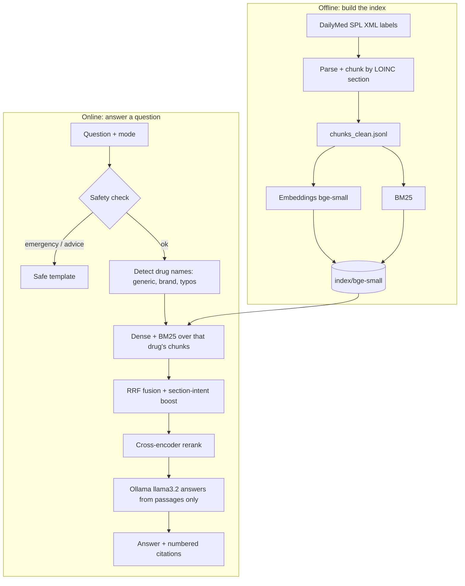

# Drug Label Q&A Chatbot (RAG)

Cognizant NPN hackathon, use case 8. Answers questions about prescription drugs from official
DailyMed labels, with section-level citations, clinician and patient modes, and safety-aware responses.

## Architecture



| Stage | Code |
|---|---|
| Data pipeline (download, parse, chunk, validate) | `scripts/download_labels.py`, `scripts/build_chunks.py`, `drugrag/pipeline/`, `scripts/validate_chunks.py` |
| Retrieval | `drugrag/retrieval/` |
| Generation + safety | `drugrag/generation/` |
| Evaluation | `drugrag/eval/` (gold set of 62 questions, results in `drugrag/eval/results/`) |
| UI | `app/app.py` (Streamlit) |

## Setup

```powershell
python -m venv venv
venv\Scripts\activate
pip install -r requirements.txt
```
Install [Ollama](https://ollama.com), then:
```powershell
ollama pull llama3.2
ollama pull llama3.1:8b      # only needed for the LLM-as-judge eval
```

## Run

1. Validate the data and build the index (the first run downloads the bge models from Hugging Face, so it needs internet):
```powershell
python scripts\validate_chunks.py data\chunks_clean.jsonl
python scripts\build_index.py --chunks data\chunks_clean.jsonl --out index\bge-small --embedder bge-small
```
2. Start the app:
```powershell
streamlit run app\app.py
```
In the sidebar keep index folder `index/bge-small` and retrieval mode `hybrid`. (The cross-encoder reranker is disabled in the app: it gave no accuracy gain in our evaluation and adds about 5 s per question.)

3. Quick retrieval check without the UI:
```powershell
python scripts\demo_retrieve.py "What are the contraindications of ibuprofen?" --index index\bge-small --compare
```

## Evaluate

```powershell
python -m drugrag.eval.eval --index index\bge-small --reranker bge-reranker-base --generate --judge-model llama3.1:8b
# quick smoke test (about 3 min, does not touch committed results):
python -m drugrag.eval.eval --index index\bge-small --no-rerank --generate --gen-modes patient --limit 15 --out scratch_results
```
Writes retrieval ablation (dense, bm25, hybrid, hybrid_rerank), generation, citation accuracy and
guardrail results to `drugrag/eval/results/`.

## Tests

```powershell
python -m pytest -q
```
Tests run offline with the `hash` embedder, mock data and a fake Ollama (53 tests).

## Data

Labels come from DailyMed (SPL XML). Each chunk is one label section with drug, section, label version,
effective date, LOINC code and source URL. Schema: `docs/chunk_schema.md`.

## Safety

The assistant answers only from retrieved label text and is not medical advice. Emergencies get an urgent
message; personal-advice questions (dose changes, stopping a drug) get a template that gives label
information and directs the user to a doctor or pharmacist.

## Documentation

- `docs/REPORT.md`: technical report (design, results, limitations)
- `docs/chunk_schema.md`: chunk schema and metadata
- `DEMO_SCRIPT.md`: rehearsed demo queries
- `tools/`: one-off data inspection helpers used while building the pipeline

## Team

Kartik Sharma (retrieval, integration), Shruti Rekha Sahoo (data pipeline), Ankita Giri (generation, safety),
Akansha Priyadarshini (evaluation, UI). Mentor: Rajaneekanta Mishra.
